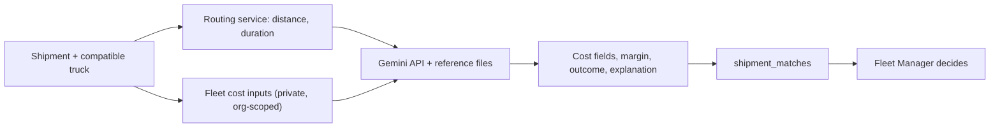

# AI Module

The AI module estimates the cost of a journey so a Fleet Manager can compare it with the Shipper's proposed payment. It gets route distance and duration from the routing service, then asks the Gemini API for a cost estimate and explanation, using Markdown reference files as background. The result fills the cost fields, `estimated_margin`, `outcome` and `ai_explanation` on `shipment_matches`.

| Page | What it covers |
|---|---|
| [Reference data](reference-data.md) | How the reference files are produced from source documents and datasets |
| [Security and privacy](security.md) | What data reaches Gemini, key handling, output boundaries |
| [Testing and evaluation](testing.md) | Required tests and the state of evaluation evidence |
| [Deployment and operations](operations.md) | Reference-file storage, Gemini file expiry and refresh, production operations |

## Inputs, outputs and model

| Item | Detail |
|---|---|
| Route inputs | Route distance and duration from the routing service |
| Fleet inputs | From `companies`: fuel price, driver allowance, toll assumption, other costs. From `trucks`: fuel consumption and maintenance per km. |
| Shipment input | The shipment's proposed amount |
| Background | The Markdown reference files |
| Outputs | Cost fields, `estimated_total_cost`, `estimated_margin`, `outcome` and `ai_explanation` on `shipment_matches` |
| Model access | The model is called through the Gemini API. No training or fine-tuning is described. |
| Failure | `estimated_total_cost` is null when the AI call fails |

The Gemini model name and version, the prompt, and the response format are not specified in the project material and are therefore not documented here.

## What the Fleet Manager sees

The cost estimation screen shows the journey, a calculated operating cost, and the AI freight estimate next to the Shipper's proposed payment.

## Interpreting estimates

ZamLine is decision support, and the Fleet Manager makes the accept or decline decision. Treat estimates as indicative, not as guaranteed costs or profit.

| Boundary | Statement |
|---|---|
| AI-generated content | `ai_explanation` is written by the model. |
| Deterministic logic | The compatibility filter, the margin subtraction (`proposed_amount` minus `estimated_total_cost`) and reservation uniqueness are application logic, not model output. |
| Human decision | Accepting or declining is done by the Fleet Manager. |
| Empty estimate | The estimate is empty when the AI call fails. A failed or incomplete result is never presented as a successful estimate. |
| Reference data | The reference data is historical and partial. |
