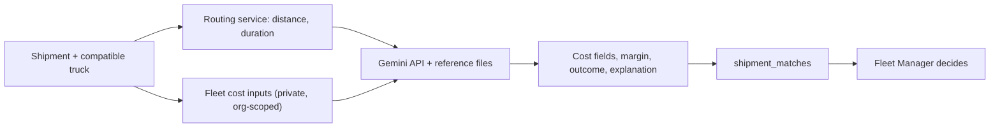
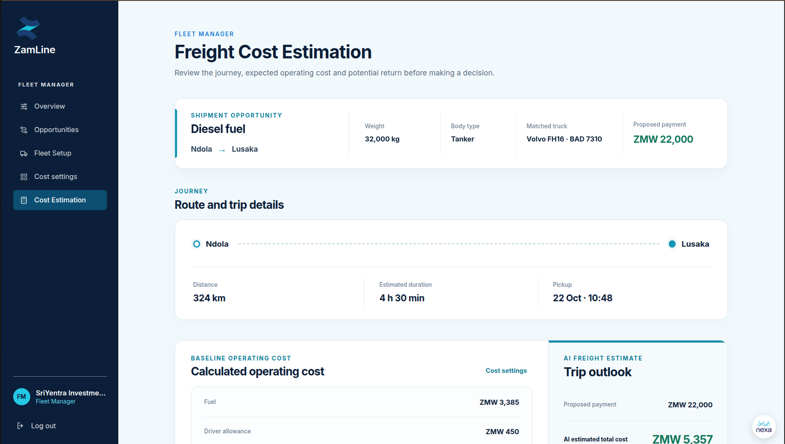

# AI Module

The AI module estimates the cost of a journey so a Fleet Manager can compare it with the Shipper's proposed payment. It gets route distance and duration from the routing service, then asks the Gemini API for a cost estimate and explanation, using Markdown reference files as background. The result fills the cost fields, `estimated_margin`, `outcome` and `ai_explanation` on `shipment_matches`.

| Page | What it covers |
|---|---|
| [Reference data](reference-data.md) | How the reference files are produced from source documents and datasets |
| [Security and privacy](security.md) | What data reaches Gemini, key handling, output boundaries |
| [Testing and evaluation](testing.md) | Required tests and the state of evaluation evidence |
| [Deployment and operations](operations.md) | Reference-file storage, Gemini file expiry and refresh, production operations |

## Inputs, outputs and model

### Model configuration

| Item | Detail |
|---|---|
| Provider | Google Gemini API |
| Model name and version | Not specified in the project material — record the deployed model name and version here once confirmed against the backend configuration, and retain them with each cost estimate for traceability |
| Model access | The model is called through the Gemini API. No training or fine-tuning is described |
| API key | Held as a server-side secret in Vault; fetched only by authorised backend services, never sent to the client |
| Version traceability | Model and provider version and assessment metadata should be retained with each cost estimate for operational traceability |

### Inputs and outputs

| Item | Detail |
|---|---|
| Route inputs | Route distance and duration from the routing service |
| Fleet inputs | From `companies`: fuel price, driver allowance, toll assumption, other costs. From `trucks`: fuel consumption and maintenance per km. |
| Shipment input | The shipment's proposed amount |
| Background | The Markdown reference files |
| Outputs | Cost fields, `estimated_total_cost`, `estimated_margin`, `outcome` and `ai_explanation` on `shipment_matches` |
| Failure | `estimated_total_cost` is null when the AI call fails |

## Prompt

The prompt sent to Gemini is built from structured context only: route distance and duration, fleet cost inputs, shipment details and the uploaded Markdown reference files. Content filtering applies. The exact prompt template is not included in the project material; record it here once confirmed against the backend implementation.

Example prompt structure (illustrative, not the production template):

```
You are a freight cost estimator for Zambian road freight.
Estimate the total cost of this journey and explain the main factors.

Route: {origin} to {destination}, {distance_km} km, {duration} minutes
Proposed payment: {proposed_amount} ZMW
Fleet cost inputs: fuel price {fuel_price} ZMW/l, driver allowance {allowance} ZMW/day,
tolls {tolls} ZMW, other costs {other} ZMW
Truck: fuel consumption {consumption} l/100 km, maintenance {maintenance} ZMW/km

Reference material:
{reference_files}

Reply in JSON with fields: estimated_total_cost, cost_breakdown, ai_explanation.
```

## Response format

The Gemini response format is not specified in the project material. Record the expected schema here once confirmed. The example below shows the shape the backend expects:

```json
{
  "estimated_total_cost": 1040.00,
  "cost_breakdown": {
    "fuel": 620.00,
    "driver": 180.00,
    "tolls": 90.00,
    "maintenance": 110.00,
    "other": 40.00
  },
  "ai_explanation": "The route is 330.5 km ... fuel price ... driver allowance ..."
}
```

The backend writes `estimated_total_cost`, `estimated_margin` (`proposed_amount` minus `estimated_total_cost`), `outcome` (`profit`, `loss` or `break_even`) and `ai_explanation` to `shipment_matches`.

## Cost-estimation process

1. The Fleet Manager selects a compatible truck for an open shipment.
2. The backend asks the routing service (Openrouteservice) for route distance and duration.
3. The backend assembles structured context: route data, private fleet cost inputs, shipment details and the Markdown reference files.
4. The backend calls the Gemini API for a cost estimate and explanation.
5. The backend stores the result on the `shipment_matches` row: `estimated_total_cost`, `estimated_margin`, `outcome` and `ai_explanation`.
6. The Fleet Manager reviews the estimate next to the Shipper's proposed payment and decides to accept or decline.

## Evaluation results

No evaluation dataset, metrics, baseline or results for the cost estimate are included in the project material, so this documentation states no accuracy figures. Do not describe the estimate as accurate or reliable without evaluation results. Until such results exist, treat estimates as indicative decision support.

An evaluation of the cost estimate would need an evaluation dataset of journeys with known costs, metrics and a baseline to compare against, results by journey type, and known failure cases. Add the artefacts and their results here when they exist.

## Limitations

| Boundary | Statement |
|---|---|
| AI-generated content | `ai_explanation` is written by the model. |
| Deterministic logic | The compatibility filter, the margin subtraction (`proposed_amount` minus `estimated_total_cost`) and reservation uniqueness are application logic, not model output. |
| Human decision | Accepting or declining is done by the Fleet Manager. |
| Empty estimate | The estimate is empty when the AI call fails. A failed or incomplete result is never presented as a successful estimate. |
| Reference data | The reference data is historical and partial. |
| Model version | The model name and version are not recorded in this documentation; confirm them against the backend before relying on specific estimate behaviour. |

## Failure behaviour

When the AI service fails (unavailable API, invalid key, invalid response, timeout):

- `estimated_total_cost` is set to null and no stale value is displayed.
- The Fleet Manager sees a controlled message that the estimate could not be completed.
- The failure is logged without provider credentials, stack traces or internal details.
- The shipment match can still be accepted or declined; the estimate is advisory only.

See also [AI testing and evaluation](testing.md) and [AI security and privacy](security.md).



## What the Fleet Manager sees

The cost estimation screen shows the journey, a calculated operating cost, and the AI freight estimate next to the Shipper's proposed payment.



## Interpreting estimates

ZamLine is decision support, and the Fleet Manager makes the accept or decline decision. Treat estimates as indicative, not as guaranteed costs or profit.
