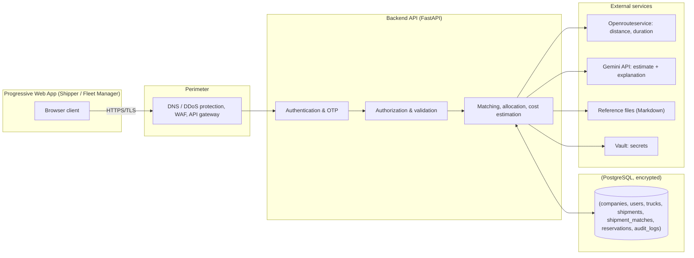

# Architecture

ZamLine is a Progressive Web App (PWA) in front of a backend API. The backend is organised into modules (authentication, business verification, shipments, fleet management, fleet matching, cost estimation, allocation and contact handoff) and stores its data in PostgreSQL. Two external services support cost estimation: a routing service for distance and duration, and the Gemini API for the cost explanation.

| Page | What it covers |
|---|---|
| This page | The two architecture diagrams and the decisions that shape the design |
| [Components and responsibilities](components.md) | What each component does, layer by layer |
| [Data flow and external services](data-flow.md) | How requests, verification, cost estimates and allocation move through the system |

## System architecture

The diagram below shows the application modules and how the two user roles reach them through the PWA. Each module reads and writes application data through the backend API. The Cost Estimation module calls the routing service and the Gemini Files API, and uses Markdown reference files for background.

## Secure architecture

The second diagram groups the same system into five layers: users and devices, perimeter security, the application layer, the data layer and external services. Traffic enters over HTTPS and passes DNS and DDoS protection, a web application firewall (WAF) and an API gateway before it reaches the backend. The diagram labels the WAF as provided by Vercel and the encrypted backup storage as Supabase.

## Component communication

The diagram below shows how the frontend, backend, database, routing service and AI service communicate in a request. Traffic from the PWA reaches the backend over HTTPS through the perimeter (DNS/DDoS protection, WAF, API gateway). The backend is the authority for authentication, authorization and data access, and it calls Openrouteservice for routes and Gemini for cost explanations.

## Deployment and configuration accuracy

The architecture diagrams reflect the deployed configuration as described in this documentation:

- The PWA is served over HTTPS with DNS and DDoS protection, a WAF (labelled as provided by Vercel in the secure architecture diagram) and an API gateway.
- The backend runs on Heroku, connects to encrypted PostgreSQL, and retrieves secrets from Vault.
- Encrypted backups are stored on Supabase with separate recovery access.
- The two diagrams (system architecture and secure architecture) show the same system: the first groups it by application modules and user roles, the second by five layers (users and devices, perimeter security, application layer, data layer, external services).
- One difference between the diagrams and the live configuration should be confirmed before a release: the WAF provider name and the Gemini file registry location (a local JSON file on the application server) affect scaling — do not scale the backend to several instances until the Gemini file registry is moved off the local server file. See [Platform deployment](../platform/deployment.md).

## Architectural decisions

| Decision | Description |
|---|---|
| Progressive Web App | One PWA serves both Shippers and Fleet Managers. |
| Layered security perimeter | DNS and DDoS protection, a WAF and an API gateway filter traffic before it reaches the backend. |
| Backend as the authority | The backend enforces authentication, authorization, validation and audit logging. The browser is never trusted for permissions or cost privacy. |
| Secret management | Credentials and application secrets are held in a secret manager (Vault), not in source code or client configuration. |
| Single-winner allocation | A uniqueness constraint on `reservations.shipment_id` and an atomic backend check prevent a shipment from being allocated twice. |
| Private fleet cost data | Fleet cost settings are scoped to the organisation that owns them. |
| Delayed contact handoff | Contact details are released only after a valid reservation. |
| Reference files for cost estimation | Markdown reference files are uploaded to the Gemini Files API. Because uploaded files expire, the backend keeps the originals and re-uploads them when needed. See [AI operations](../ai/operations.md). |
