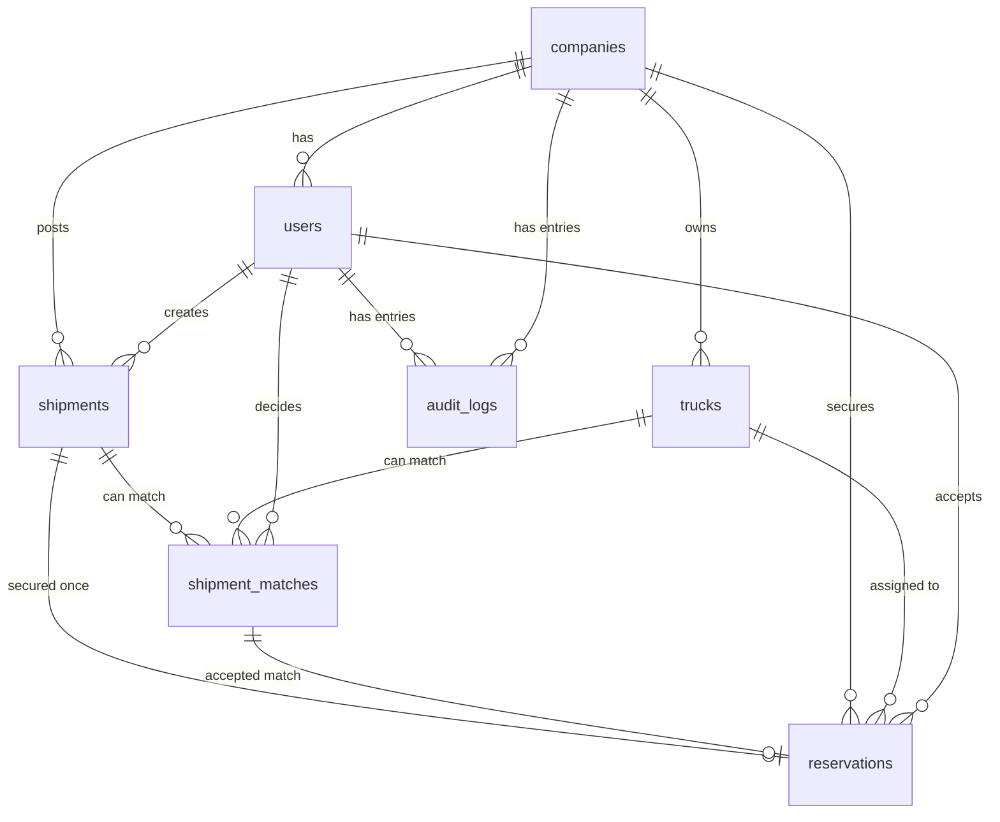
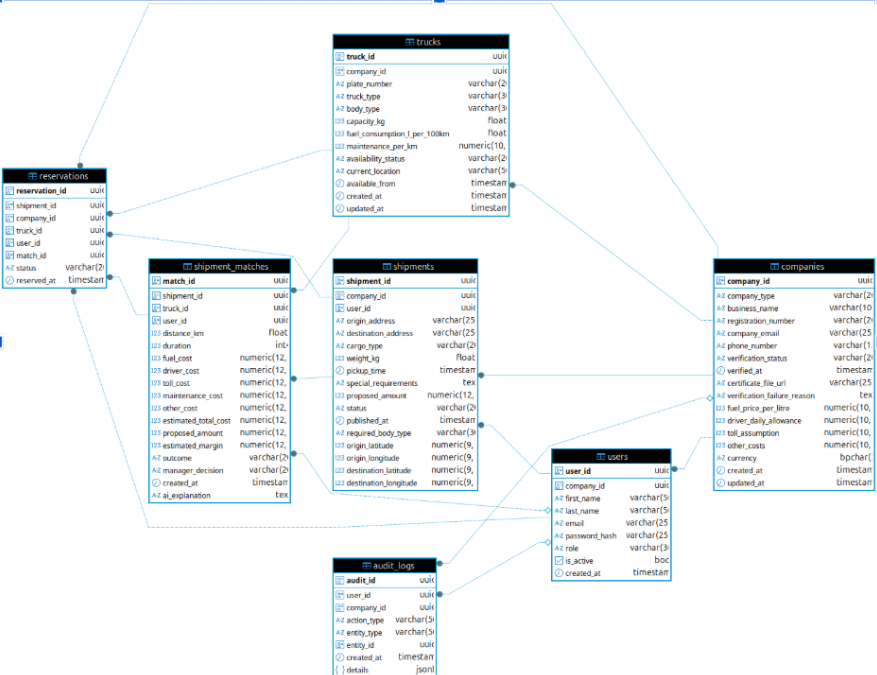

# Data model

The database has seven tables: `companies`, `users`, `trucks`, `shipments`, `shipment_matches`, `reservations` and `audit_logs`. PostgreSQL is the database.

In the tables below, **Req** is `R` for required and `O` for optional. Columns that accept a fixed set of values are stored as `VARCHAR` in the database; the permitted values are listed in the Constraints column.

## Entity relationship diagram

## companies

Business profile for shippers and fleet companies, the latest PACRA verification result, and for fleet companies only, private cost settings. Cost columns are NULL for shippers and must be returned only to users of the same company. Only the latest verification result is kept here; every attempt is kept in `audit_logs`.

| Column | SQL type | Req | Constraints | Description |
|---|---|---|---|---|
| company_id | UUID | R | PK | System generated identifier. |
| company_type | VARCHAR | R | `shipper` or `fleet` | Shipper posts freight; fleet owns trucks and accepts freight. |
| business_name | VARCHAR(100) | R |  | Registered business name entered at sign-up. |
| registration_number | VARCHAR(20) | R | UNIQUE | PACRA registration number. Prevents duplicate registration. |
| company_email | VARCHAR(255) | R | UNIQUE | Official company email. |
| phone_number | VARCHAR(15) | R |  | Shared with the other party only after a valid reservation. |
| verification_status | VARCHAR | R | DEFAULT `pending`; `pending`, `verified`, `resubmit`, `rejected` | Controls whether the company can post or accept shipments. `resubmit` means data is missing, unreadable or mismatched. |
| verified_at | TIMESTAMP | O |  | When the company became verified. Used for activation metrics. |
| certificate_file_url | VARCHAR(255) | O |  | Storage link to the latest uploaded certificate. |
| verification_failure_reason | TEXT | O |  | Reason the last attempt failed, for example QR not found or name mismatch. |
| fuel_price_per_litre | DECIMAL(10,2) | O | CHECK > 0 | Fleet only. Fuel price used in estimates. |
| driver_daily_allowance | DECIMAL(10,2) | O |  | Fleet only. Daily driver allowance. |
| toll_assumption | DECIMAL(10,2) | O | DEFAULT 0 | Fleet only. Expected toll cost per trip. |
| other_costs | DECIMAL(10,2) | O | DEFAULT 0 | Fleet only. Other operating cost per trip. |
| currency | CHAR(3) | O |  | Three-character currency code. |
| created_at | TIMESTAMP | R | DEFAULT now() | Record creation time. |
| updated_at | TIMESTAMP | R | DEFAULT now() | Last change time. |

## users

Login details. A user always belongs to one company, which keeps each company's data separate. Data comes from the registration form.

| Column | SQL type | Req | Constraints | Description |
|---|---|---|---|---|
| user_id | UUID | R | PK | System generated identifier. |
| company_id | UUID | R | FK to companies.company_id | The user's company. |
| first_name | VARCHAR(50) | R |  | First name. |
| last_name | VARCHAR(50) | R |  | Last name. |
| email | VARCHAR(255) | R | UNIQUE | Login email. |
| password_hash | VARCHAR | R |  | Password hash used for email and password login. |
| role | VARCHAR | R | `shipper` or `fleet_manager` | Decides which screens and actions the user can access. |
| is_active | BOOLEAN | R | DEFAULT TRUE | Whether the account can log in. |
| created_at | TIMESTAMP | R | DEFAULT now() | Account creation time. |

## trucks

Trucks owned by fleet companies. Body type, capacity and availability drive the compatibility filter. Fuel use and maintenance cost are stored per truck because they differ between vehicles. Data comes from the fleet setup screen.

| Column | SQL type | Req | Constraints | Description |
|---|---|---|---|---|
| truck_id | UUID | R | PK | Identifier. |
| company_id | UUID | R | FK to companies.company_id | Owning fleet company. |
| plate_number | VARCHAR(20) | R | UNIQUE | Number plate. Blocks duplicates. |
| truck_type | VARCHAR(30) | R |  | Category, for example rigid or semi-trailer. |
| body_type | VARCHAR | R | `flatbed`, `box`, `tanker`, `refrigerated`, `tipper`, `container` | Compared with the shipment's `required_body_type`. |
| capacity_kg | FLOAT | R | CHECK > 0 | Maximum load in kg. Compared with the shipment's `weight_kg`. |
| fuel_consumption_l_per_100km | FLOAT | R | CHECK > 0 | Private. Average fuel use per 100 km. |
| maintenance_per_km | DECIMAL(10,2) | R |  | Private. Maintenance cost per km. |
| availability_status | VARCHAR | R | DEFAULT `available`; `available`, `unavailable` | Only `available` trucks are used for matching. Changed manually by the fleet manager. |
| current_location | VARCHAR(50) | O |  | Town or place where the truck is available. |
| available_from | TIMESTAMP | O |  | When the truck becomes free. |
| created_at | TIMESTAMP | R | DEFAULT now() | When the truck was added. |
| updated_at | TIMESTAMP | R | DEFAULT now() | Last change time. |

## shipments

Freight opportunities posted by shippers: route, cargo, pickup time and proposed payment. Only `open` shipments appear to fleet managers.

| Column | SQL type | Req | Constraints | Description |
|---|---|---|---|---|
| shipment_id | UUID | R | PK | Identifier. |
| company_id | UUID | R | FK to companies.company_id | Shipper company that posted it. |
| user_id | UUID | R | FK to users.user_id | User who created it. |
| origin_address | VARCHAR(250) | R |  | Pickup location as text. |
| origin_latitude | NUMERIC(9,6) | R | CHECK -90 to 90 | Pickup latitude. |
| origin_longitude | NUMERIC(9,6) | R | CHECK -180 to 180 | Pickup longitude. |
| destination_address | VARCHAR(250) | R |  | Delivery location as text. |
| destination_latitude | NUMERIC(9,6) | R | CHECK -90 to 90 | Delivery latitude. |
| destination_longitude | NUMERIC(9,6) | R | CHECK -180 to 180 | Delivery longitude. |
| cargo_type | VARCHAR(20) | R |  | Kind of cargo, for example maize or copper cathode. |
| weight_kg | FLOAT | R | CHECK > 0 | Cargo weight in kg. |
| required_body_type | VARCHAR | R | `flatbed`, `box`, `tanker`, `refrigerated`, `tipper`, `container` | Truck body type the cargo needs. Validated against the supported truck body-type values. |
| pickup_time | TIMESTAMP | R |  | Earliest pickup time. |
| special_requirements | TEXT | O |  | Extra notes such as permits or handling needs. |
| proposed_amount | DECIMAL(12,2) | R | CHECK > 0 | Amount the shipper is willing to pay. |
| status | VARCHAR | R | DEFAULT `open`; `open`, `confirmed`, `cancelled`, `expired` | Lifecycle. Becomes `confirmed` when a fleet manager accepts. |
| published_at | TIMESTAMP | R | DEFAULT now() | When the shipment became visible. |

## shipment_matches

Possible matches between a shipment and a compatible truck. Holds the route, the cost estimate and the fleet manager's decision. A shipment and truck pair can appear only once.

Table-level constraint: `UNIQUE (shipment_id, truck_id)`.

The `decided_at` column is part of the data model specification but does not appear in the [schema export](#database-schema-export).

| Column | SQL type | Req | Constraints | Description |
|---|---|---|---|---|
| match_id | UUID | R | PK | Identifier. |
| shipment_id | UUID | R | FK to shipments.shipment_id | Matched shipment. |
| truck_id | UUID | R | FK to trucks.truck_id | Matched truck. |
| user_id | UUID | O | FK to users.user_id | Fleet manager who made the decision. |
| distance_km | FLOAT | O |  | Route distance. Empty until the manager selects the match. |
| duration | INTEGER | O |  | Estimated journey time in minutes. |
| fuel_cost | DECIMAL(12,2) | O |  | Estimated fuel cost. |
| driver_cost | DECIMAL(12,2) | O |  | Estimated driver cost. |
| toll_cost | DECIMAL(12,2) | O |  | Estimated toll cost. |
| maintenance_cost | DECIMAL(12,2) | O |  | Estimated maintenance cost. |
| other_cost | DECIMAL(12,2) | O |  | Other estimated costs. |
| estimated_total_cost | DECIMAL(12,2) | O |  | Estimated total journey cost. Empty if the AI call failed. |
| proposed_amount | DECIMAL(12,2) | O |  | Shipper's proposed payment at the time of the estimate. |
| estimated_margin | DECIMAL(12,2) | O |  | `proposed_amount` minus `estimated_total_cost`. |
| outcome | VARCHAR | O | `profit`, `loss`, `break_even` | Financial category of the margin. The cost-estimation logic applies the thresholds; they are not specified here. |
| ai_explanation | TEXT | O |  | Written explanation of the main factors behind the estimate. |
| manager_decision | VARCHAR | R | DEFAULT `pending`; `pending`, `accepted`, `declined`, `closed` | `closed` is set when another company secures the shipment first. Accepted and declined are both stored. |
| created_at | TIMESTAMP | R | DEFAULT now() | Match creation time. |
| decided_at | TIMESTAMP | O |  | When the manager decided. |

## reservations

Records which fleet company secured a shipment. Created only at the moment of a valid acceptance, so no row exists while a shipment is waiting. The unique constraint on `shipment_id` means two companies can never claim the same load.

| Column | SQL type | Req | Constraints | Description |
|---|---|---|---|---|
| reservation_id | UUID | R | PK | Identifier. |
| shipment_id | UUID | R | FK to shipments.shipment_id, UNIQUE | One reservation per shipment. |
| company_id | UUID | R | FK to companies.company_id | Fleet company that secured the shipment. |
| truck_id | UUID | R | FK to trucks.truck_id | Truck assigned. |
| user_id | UUID | R | FK to users.user_id | Fleet manager who accepted. |
| match_id | UUID | R | FK to shipment_matches.match_id | The accepted match with its cost estimate. |
| status | VARCHAR | R | `accepted`, `cancelled` | `accepted` when created; `cancelled` if the arrangement is later called off. |
| reserved_at | TIMESTAMP | R | DEFAULT now() | When the shipment was secured. |

## audit_logs

General log of user actions such as viewing, assessing, accepting and publishing. Written by the backend API for every module. See [Audit events](index.md#audit-events).

| Column | SQL type | Req | Constraints | Description |
|---|---|---|---|---|
| audit_id | UUID | R | PK | Identifier. |
| user_id | UUID | O | FK to users.user_id | User who did the action. |
| company_id | UUID | O | FK to companies.company_id | Company of the user. |
| action_type | VARCHAR(50) | R |  | Action name, for example `shipment_published`, `shipment_viewed`, `verification_attempted`, `contact_viewed`. |
| entity_type | VARCHAR(50) | O |  | Type of record affected, for example shipment or reservation. |
| entity_id | UUID | O |  | ID of the affected record. |
| details | JSONB | O |  | Event details such as QR result, OCR result, match outcome or failure reason. |
| created_at | TIMESTAMP | R | DEFAULT now() | Time of the action. |

## Relationships

| From | To | Type | Meaning |
|---|---|---|---|
| companies | users | One-to-many | A company has many users. |
| companies | trucks | One-to-many | A fleet company owns many trucks. |
| companies | shipments | One-to-many | A shipper company posts many shipments. |
| users | shipments | One-to-many | A user creates many shipments. |
| shipments | shipment_matches | One-to-many | A shipment can match many trucks. |
| trucks | shipment_matches | One-to-many | A truck can match many shipments. |
| companies | shipment_matches | One-to-many | Through the trucks it owns. |
| users | shipment_matches | One-to-many | A fleet manager decides on many matches. |
| shipments | reservations | One-to-one | A shipment is secured only once. |
| shipment_matches | reservations | One-to-one | An accepted match leads to one reservation. |
| companies | reservations | One-to-many | A fleet company secures many shipments over time. |
| trucks | reservations | One-to-many | A truck is assigned to many reservations over time. |
| users | reservations | One-to-many | A fleet manager accepts many shipments over time. |
| users | audit_logs | One-to-many | A user has many log entries. |
| companies | audit_logs | One-to-many | A company has many log entries. |

## Database schema export

The diagram below is an export of the database schema. Its tables and columns match this page with one exception: it does not include `shipment_matches.decided_at`. Confirm that column against the migrations before relying on it. Enumerated columns appear as `VARCHAR` in the export, which is why they are listed that way above.

Show the exported schema diagram

