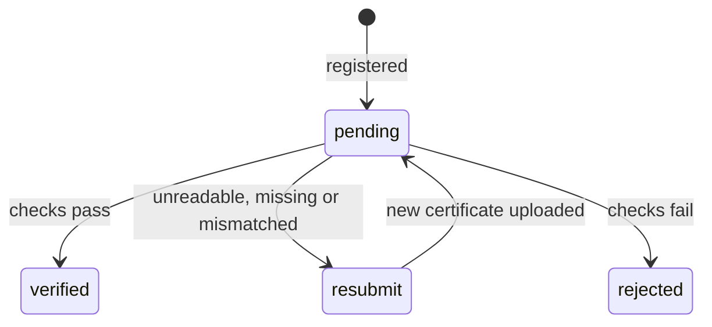
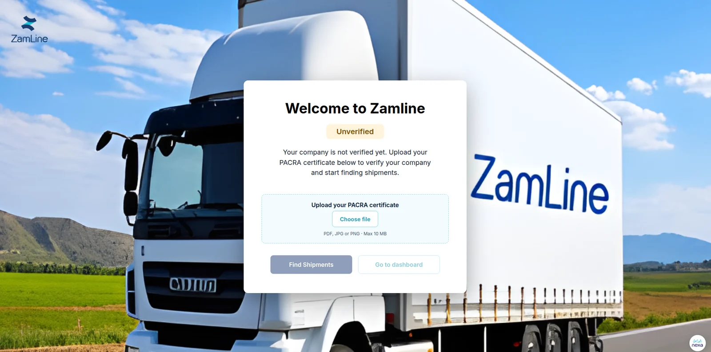

# Business verification

Business verification confirms that a company is registered before it can post or accept shipments. Both company types (`shipper` and `fleet`) verify with a **PACRA certificate**, which is the registration certificate issued by the Patents and Companies Registration Agency and carries a QR code. Only the storage link is kept in the database (`companies.certificate_file_url`). The file itself is held in separate storage.

## How verification works

| Item | Detail |
|---|---|
| Input | A PACRA QR-enabled certificate, uploaded as a file |
| Checks | File type and size, QR processing, OCR processing, and consistency rules between the QR and OCR results |
| Result | `companies.verification_status`: `pending`, `verified`, `resubmit` or `rejected`. `resubmit` means data is missing, unreadable or mismatched. |
| Failure detail | `companies.verification_failure_reason`, for example "QR not found" or "name mismatch" |
| Timestamp | `companies.verified_at` records when the company became verified |
| Audit | Every attempt is logged as `verification_attempted`, with the QR and OCR results in `audit_logs.details` |
| Failure behaviour | Verification fails safely when information cannot be reliably processed |

## Security requirements

| Requirement | Priority |
|---|---|
| Certificates are checked for file type and size. The upload limit is 10 MB. | High |
| QR and OCR processing fails safely and rejects when results are unreliable | High |
| Uploads are stored in controlled storage and processed safely, with restricted access to certificates | High |
| The QR and OCR consistency check uses deterministic rules and rejects safely | High |

| Threat | Required control |
|---|---|
| Unsafe file upload | File type and size validation, controlled storage, safe processing |
| Incorrect business verification | QR and OCR consistency checks, deterministic rules, fail-safe rejection |

Certificates are high-sensitivity data and may contain details of company representatives. See [Privacy and retention](../security/privacy-and-retention.md).

## Testing

Unsupported, corrupted, oversized and malformed certificates must fail safely. See [Backend testing](testing.md#verification-and-uploads).

## Deployment

Certificate files are held in controlled storage separate from the database, and access is restricted to authorized verification workflows. See [Backend deployment](deployment.md).

## Screens

Registration includes the certificate upload area. A company that has not yet been verified sees a prompt to upload its PACRA certificate.

