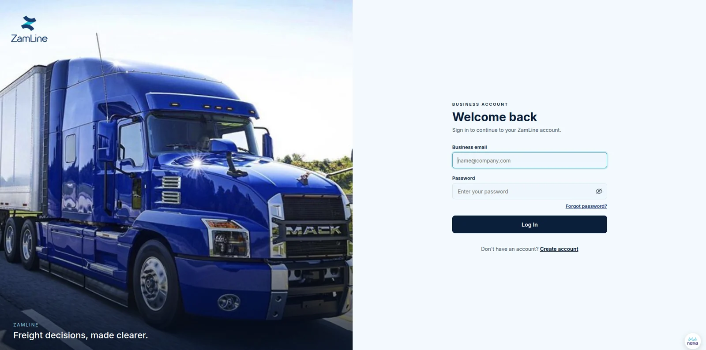
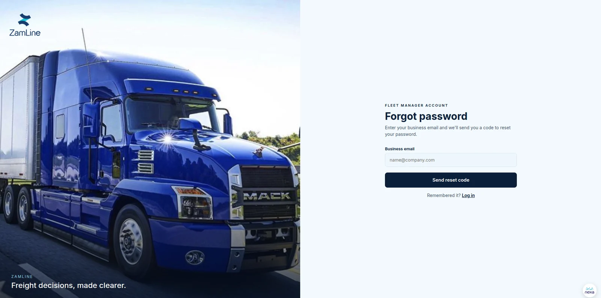

# Frontend

The ZamLine frontend is a Progressive Web App (PWA) used by both Shippers and Fleet Managers. It is the interface through which users register, verify their business, publish and review shipments, manage fleets and decide on loads. It does not enforce permissions: the backend does, so hiding a screen is never a security control.

| Page | What it covers |
|---|---|
| [Pages and workflows](workflows.md) | The screens and step-by-step flows for each role |
| [Security](security.md) | Requirements that affect the PWA |
| [Testing](testing.md) | Required and recommended frontend tests |
| [Deployment](deployment.md) | Frontend release requirements |

## Pages by role

The sidebar of the signed-in application differs by role.

| Role | Pages |
|---|---|
| Shipper | Dashboard, Post Shipment, Current Shipments, Accepted Shipments, Profile |
| Fleet Manager | Overview, Opportunities, Booked Loads, Fleet Setup, Cost Settings, Cost Estimation, Profile |

Before sign-in, the landing screen asks the user to continue as a Shipper or a Fleet Manager.

## Authentication screens

Users sign in with a business email and password, then confirm a one-time code sent by email. A "Forgot password?" link starts account recovery.

Registration and business verification are covered in [Business verification](../backend/verification.md#screens).

## Technology

The PWA's framework, routing, project structure, API base URL, request mechanism, state management, build tooling and hosting are not documented here, because the frontend repository was not available when this documentation was prepared. These pages describe the product behaviour that the screens show and the requirements the frontend must meet. Add the technology details to this page once they are confirmed.
