# Pages and workflows

This page walks through the main journey of each role, with screens from the application.

## Shipper

| Workflow | What happens |
|---|---|
| Post a shipment | The Shipper enters origin, destination, cargo type, weight, required body type, pickup time, special requirements and the proposed amount, and confirms before the shipment is published. |
| Track status | A shipment's status is `open`, `confirmed`, `cancelled` or `expired`. |
| View the match and contact | After a valid acceptance, the Shipper sees the accepting fleet company and its permitted contact details. |

**Dashboard.** Summary counts and recent shipments.

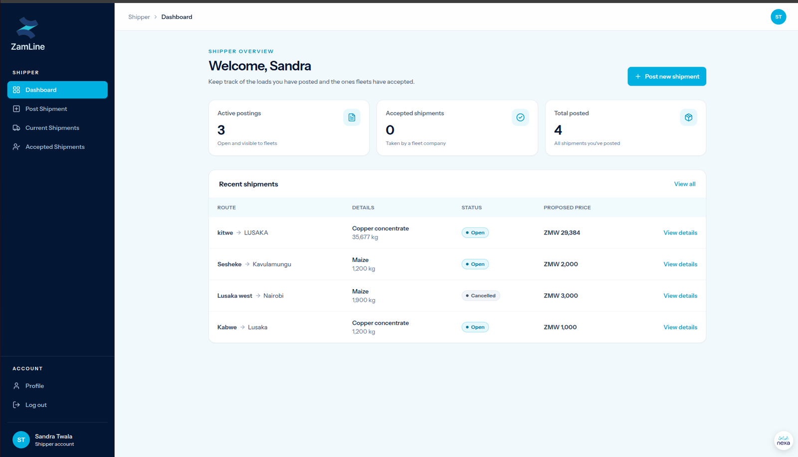

**Post a shipment.** One form for route and cargo, and pickup and payment details.

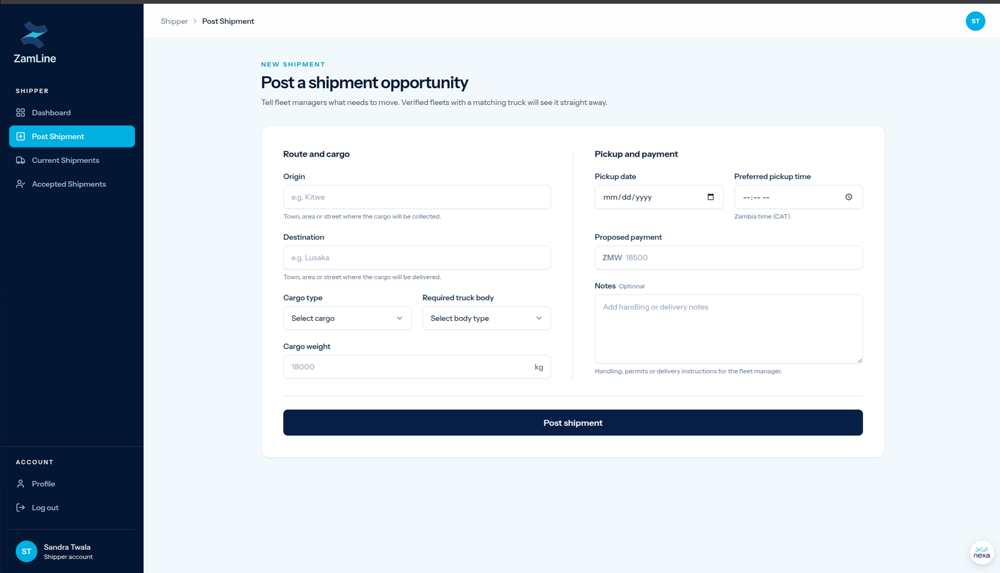

**Current shipments.** The Shipper's published shipments and their status.

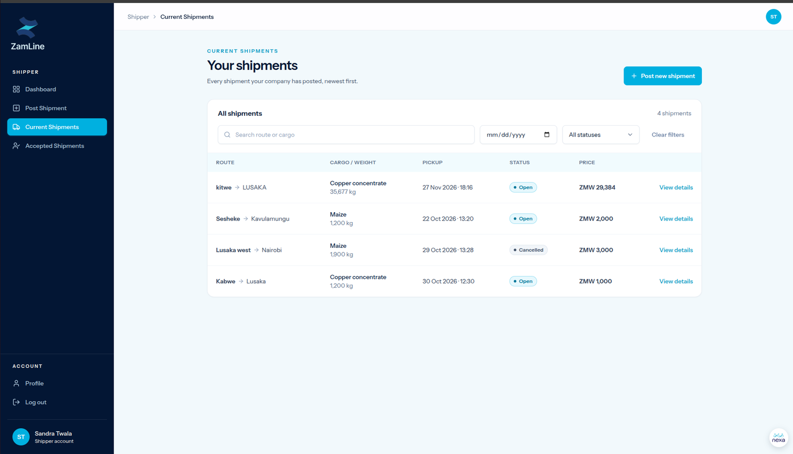

**Accepted shipments.** Shipments that a fleet company has secured, with the fleet company, agreed price, pickup time and status.

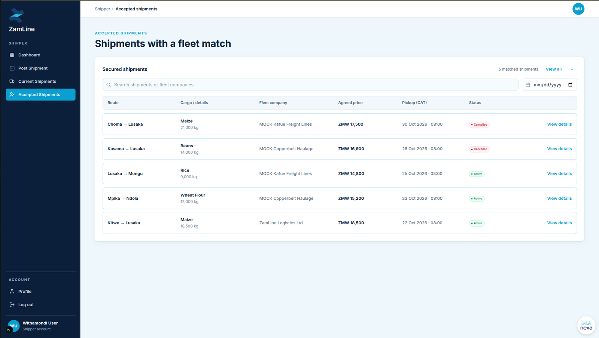

## Fleet Manager

| Workflow | What happens |
|---|---|
| Fleet setup | Add trucks with plate number, type, body type, capacity, fuel use, maintenance per km, availability and location. |
| Cost settings | Set private cost inputs: fuel price, driver allowance, tolls and other costs. These are visible only to the owning company. |
| Opportunities | See only `open` shipments that an `available` truck can carry, matched on body type and capacity. |
| Cost estimation | Review route distance and duration, the estimated costs, the margin against the proposed amount, the outcome and the explanation. |
| Accept or decline | Both decisions are stored. The first valid acceptance secures the shipment. |
| Booked loads | See the loads the company has secured, their status, and the shipper's contact details. |

**Overview.** Opportunities ready to review, matched trucks and the cost settings status.

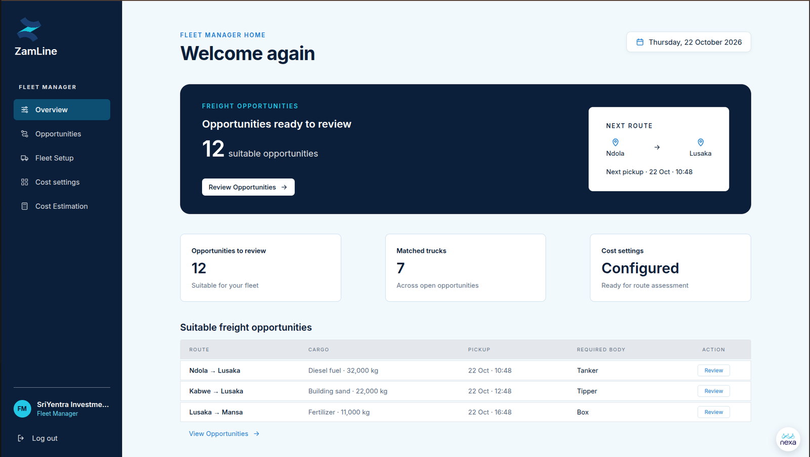

**Fleet setup.** Choose the truck types the company operates, then set the carrying capacity and availability of each truck in the fleet.

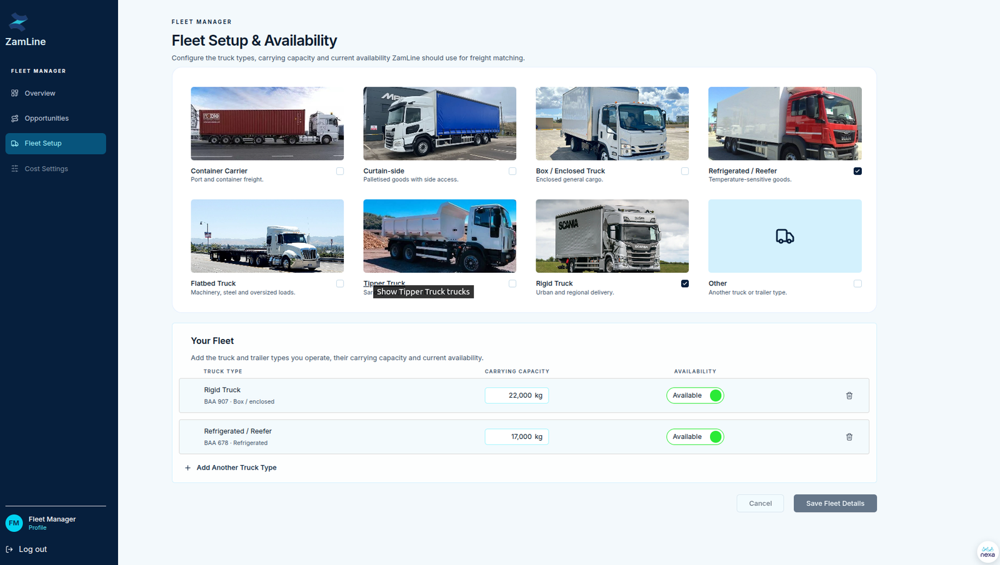

Selecting a truck opens its details, such as plate number, body type, capacity, fuel consumption and maintenance cost.

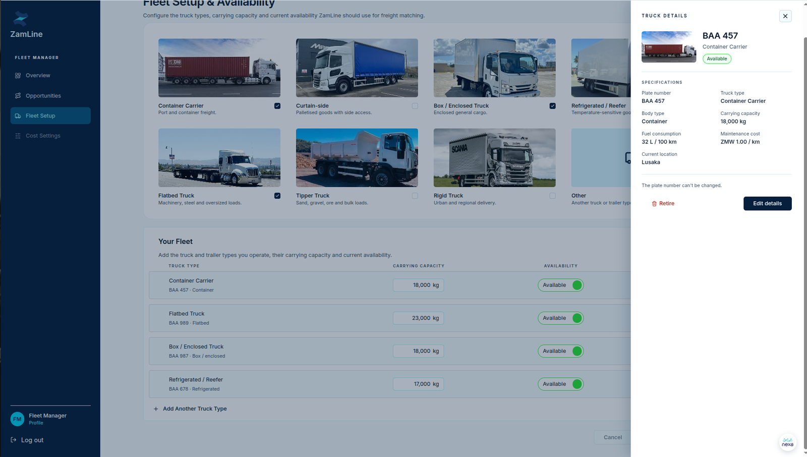

**Cost settings.** Private operating-cost inputs. The screen states that these values support the Fleet Manager's own review and never appear as public shipment information.

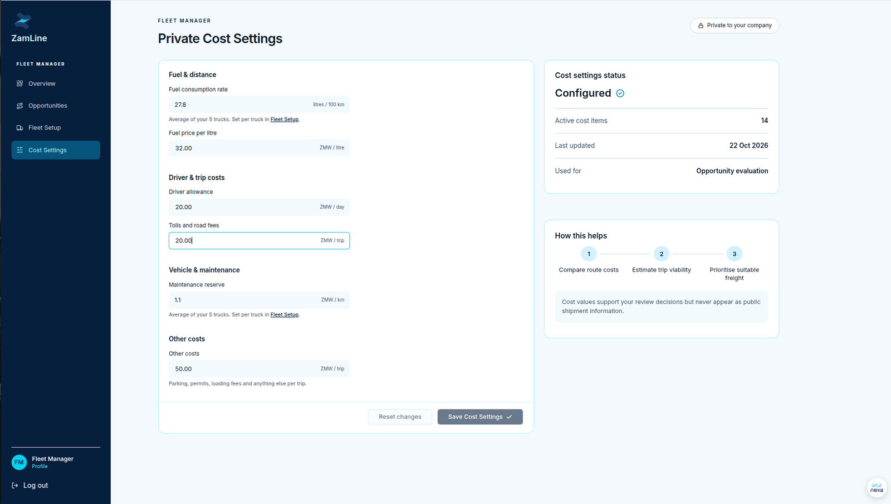

**Opportunities.** Compatible shipments with route, body type, weight, matched truck, pickup time and proposed payment.

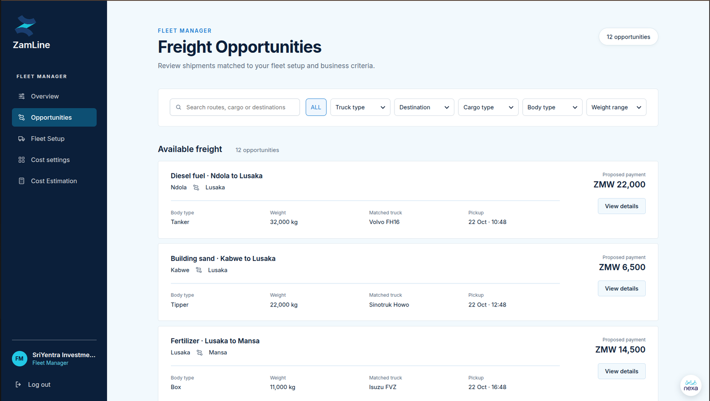

**Cost estimation.** See [AI Module](../ai/index.md#what-the-fleet-manager-sees) for the cost estimation screen.

**Booked loads.** Each booked load shows its route, cargo, shipper, agreed price, pickup time and status (`Active` or `Cancelled`).

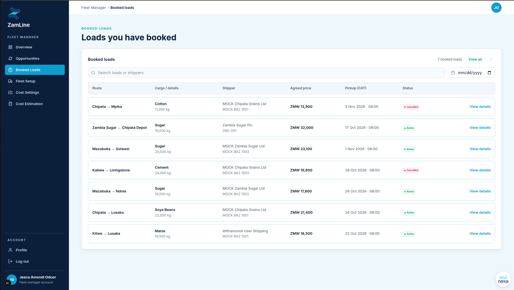

**Booking details.** After a booking, the Fleet Manager sees the shipper's business contact details and a booking reference. Contact details are available only in this post-allocation state.

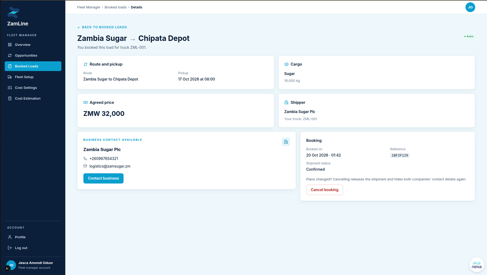

### Cancelling a booking

A Fleet Manager can cancel a booking and may give a reason. The confirmation dialog says that both companies' contact details are hidden again and that the action cannot be undone.

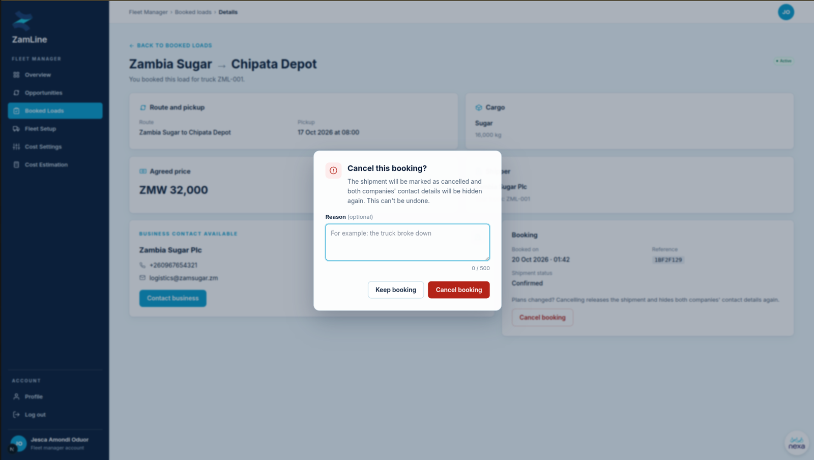

