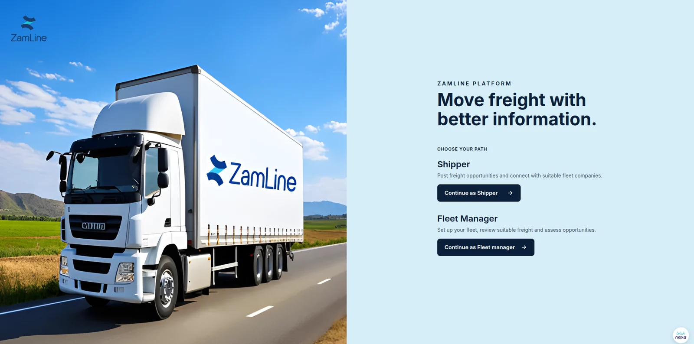

<!-- 
TEAM NEXA · TECHNICAL HANDBOOK

# ZamLine -->

ZamLine brings shipment opportunities, fleet requirements, route information and operating-cost estimates into one workflow for verified Shippers and Fleet Managers in Zambia.

[Start with the problem](start-here/index.md){ .md-button .md-button--primary }
[Explore the architecture](architecture/index.md){ .md-button }

## What ZamLine does

Zambia's road freight depends on manual trip planning and costing, and available truck capacity is not always used well. ZamLine connects the two sides of that problem. Shippers publish loads. Fleet Managers see the loads their trucks can carry, review route and cost information, and decide whether to accept. The first valid acceptance reserves the load for one fleet company and releases contact details between the two businesses.

[Read the full problem statement](start-here/index.md){ .md-button }

## Find what you need

-   :material-layers-triple: **[Architecture](architecture/index.md)**

    Components, responsibilities, data flow and external services.

-   :material-api: **[Backend](backend/index.md)**

    Service modules, API design, data model, business verification, deployment.

-   :material-brain: **[AI Module](ai/index.md)**

    Cost estimation, reference data, security and operations.

-   :material-monitor-dashboard: **[Frontend](frontend/index.md)**

    The Progressive Web App, with screens for both user roles.

-   :material-server-network: **[Platform](platform/index.md)**

    Perimeter, secrets, database, backups and configuration.

-   :material-shield-check: **[Security](security/index.md)**

    Security requirements, where each is covered, privacy and retention.

-   :material-code-braces: **[Developer Guide](developer-guide/index.md)**

    Where to make changes, standards, testing and release checks.

-   :material-book-alphabet: **[Glossary](reference/glossary.md)**

    Project terms and acronyms.

## Platform capabilities

| Capability | What it supports |
|---|---|
| Business verification | PACRA certificate upload, QR and OCR processing, verification outcomes |
| Shipment management | Shipment creation, publication and status tracking |
| Fleet management | Fleet profiles, truck information, capacity and availability |
| Matching and reservations | Compatibility review and single-winner shipment allocation |
| Route information | Heavy-goods-vehicle route distance and estimated journey duration |
| Cost decision support | Operating-cost inputs, curated freight references and AI-generated explanations |
| Security and governance | Role and organisation access boundaries, audit trail, protected secrets, retention policy |
